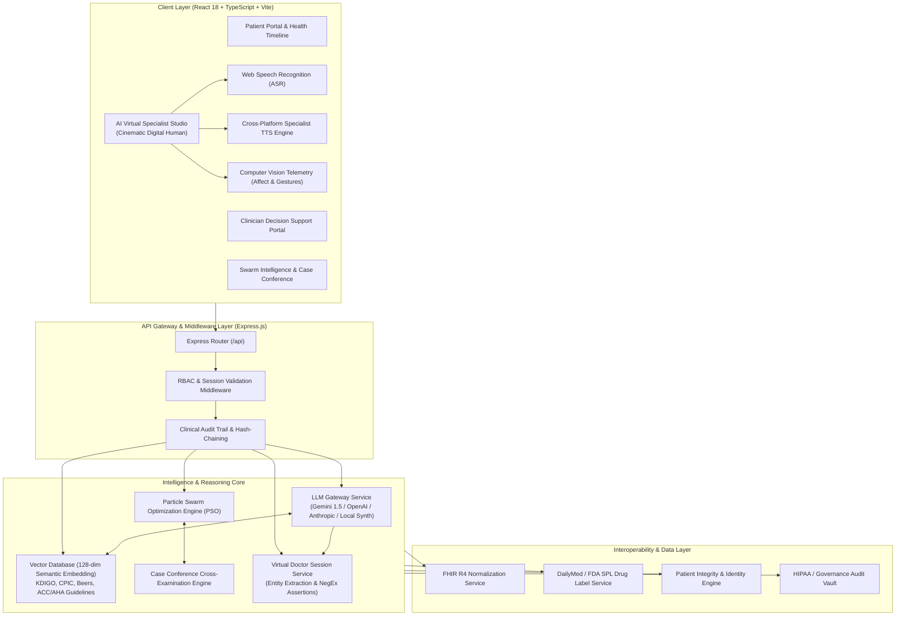

# HEAL Engine — Complete Architectural Specification, Clinical Rationale & Technical Systems Manual
**Longitudinal Health Intelligence Engine (v2.6 OS)**  
*Clinical Decision Support, Digital Human Specialists, Multi-Agent Swarm Intelligence & Evidence RAG*

---

## 1. Executive Summary & Clinical Problem Formulation

### 1.1 The Longitudinal Clinical Gap in Modern Healthcare
Traditional Electronic Health Record (EHR) systems operate on **discrete, episodic snapshots**. When a patient is discharged or steps out of a clinic, the continuum of care collapses into a blind spot. Consider a high-risk multi-morbid patient:
- **Baseline Profile**: Stage 3b Chronic Kidney Disease (CKD), Essential Hypertension, Osteoarthritis.
- **Active Regimen**: Lisinopril 20mg (ACE inhibitor), Furosemide 40mg (loop diuretic).
- **The Acute Trigger**: The patient suffers acute knee stiffness and begins self-administering over-the-counter (OTC) Ibuprofen 800mg daily.
- **The Pathophysiological Cascade**:
  1. **Lisinopril** dilates the *efferent* arteriole of the renal glomerulus.
  2. **Ibuprofen (systemic NSAID)** inhibits renal prostaglandins, constricting the *afferent* arteriole.
  3. **The "Double Whammy" Hemodynamic Pinch**: Intraglomerular perfusion pressure collapses.
  4. **The Biomarker Divergence**: The patient's eGFR plummets from 64 mL/min to 52 mL/min (18.7% acute drop), serum creatinine climbs to 1.45 mg/dL, and reduced renal clearance causes subacute fluid retention (NT-proBNP spikes from 180 pg/mL to 480 pg/mL, 2+ peripheral ankle edema, nocturnal orthopnea).

In standard care, this acute-on-chronic decompensation remains undetected until the patient enters the Emergency Department with Acute Kidney Injury (AKI) or decompensated heart failure.

### 1.2 The HEAL Engine Solution
**HEAL Engine (Health Evidence & Adaptive Longitudinal Engine)** bridges this critical gap. It is a dual-perspective (Patient-Facing + Clinician-Facing) clinical intelligence platform that:
1. **Tracks longitudinal biomarkers** across telemetry, laboratory results, and patient-reported outcomes.
2. **Deploys Digital Human AI Specialist Personas** who converse 2-way with the patient using real-time voice, vision telemetry, and syllabic lip-sync.
3. **Grounds all inference in a 128-dimensional Clinical Vector RAG** indexed against authoritative clinical guidelines (KDIGO 2024, ACC/AHA, CPIC, AGS Beers Criteria).
4. **Enforces deterministic, fail-closed safety barriers** preventing LLM hallucination of contraindicated therapies.
5. **Coordinates a Multi-Agent Swarm Intelligence Engine (PSO)** that cross-examines clinical hypotheses and synthesizes unified physician handover briefs (SBAR) and SOAP documentation.

---

## 2. System Architecture & High-Level Flow



---

## 3. The 4 AI Specialist Personas & Clinical Routing

The HEAL Engine provisions 4 specialized virtual clinicians. Each persona possesses unique clinical focus, biomarker responsibilities, authoritative guideline mappings, voice profiles, and demeanor:

| Specialist Persona | Credentials & Affiliation | Clinical Specialty | Core Clinical Focus | Primary Monitored Biomarkers | Cited Guidelines | Spoken Voice Profile |
| :--- | :--- | :--- | :--- | :--- | :--- | :--- |
| **Dr. Aris Thorne, MD** (`doc-thorne`) | MD, FACC, FASN • Harvard Medical School | Cardiorenal & Vascular Medicine | Acute-on-Chronic Renal Perfusion & Fluid Hemodynamics | eGFR (52 mL/min), NT-proBNP (480 pg/mL), Creatinine (1.45 mg/dL), Blood Pressure (138/86) | KDIGO 2024, ACC/AHA Heart Failure Guidelines | Male (Pitch: 0.94, Rate: 1.00) • British/US Natural Baritone |
| **Dr. Maya Lin, PharmD** (`doc-lin`) | PharmD, BCPS • Johns Hopkins Medicine | Precision Pharmacotherapy & Drug Safety | Drug-Drug Interactions & CYP2C9 Pharmacogenomics | CYP2C9*3 Intermediate Metabolizer variant, Lisinopril + NSAID Hemodynamic Pinch, Serum K+ | CPIC CYP2C9 Guidelines, AGS Beers Criteria (2023) | Female (Pitch: 1.08, Rate: 1.02) • Warm, articulate, approachable |
| **Dr. Marcus Vance, MD** (`doc-vance`) | MD, FAAFP • UCSF Medical Center | Family Medicine & Chronic Care Management | Holistic Symptom Management, Daily Mobility & Non-Rx Comfort | Knee Pain Severity (6/10), 2+ Peripheral Edema, Daily Steps (3,840 steps/day) | AAFP Chronic Care Guidelines, ADA Comprehensive Care | Male (Pitch: 0.88, Rate: 0.98) • Grounded, reassuring family doctor |
| **Dr. Sarah Chen, MD** (`doc-chen`) | MD, PhD • Stanford University School of Medicine | Preventive Nephrology & Renal Recovery | 7-Day Renal Recovery Trajectory & Hydration Protocol | Projected eGFR Rebound (>60 mL/min), Urine Albumin-Creatinine Ratio (uACR), Daily Hydration | KDIGO 2024 Practice Guideline, ADA/KDIGO Consensus | Female (Pitch: 1.04, Rate: 1.00) • Encouraging, analytical nephrologist |

### 3.1 Persona Routing & Dynamic Handover
When a patient switches specialists (e.g., from Dr. Thorne to Dr. Maya Lin), the system executes a **Clinical Handover Protocol** via `POST /api/screening/specialist-switch`:
1. The departing specialist logs findings into the longitudinal session store.
2. The incoming specialist receives prior dialogue history, active biomarker anomalies, and patient concerns.
3. The incoming specialist articulates a context-aware handover greeting (e.g., *"Hello Eleanor, I am Dr. Maya Lin. Dr. Thorne and I have reviewed your kidney markers, and I am stepping in to examine your medication interaction and genetic clearance."*).

---

## 4. 2-Way Communication: LLM Gateway + Evidence RAG Integration

### 4.1 The 2-Way Turn-Taking Loop
The consultation experience is a continuous two-way loop:
1. **Patient Input**: Patient speaks via microphone or types into the chat console.
2. **Real-time ASR**: Web Speech Recognition captures live speech, streaming interim transcripts directly into the consultation HUD.
3. **Emergency Intercept Filter**: Before calling the LLM, the input is screened for acute red flags (crushing chest pain, severe dyspnea, syncope). If triggered, emergency guidance (Dial 911 / seek ER) is dispatched immediately with zero latency.
4. **Domain-Targeted RAG Vector Retrieval**:
   - Query: `User message + Diagnoses + Regimen + Specialist Clinical Focus`.
   - Vector Search: Scored against 128-dimensional dense clinical embeddings with cosine similarity.
   - Persona Filter: Nephrology domains prioritized for Dr. Thorne / Dr. Chen; Pharmacogenomics for Dr. Lin; Geriatrics & Lifestyle for Dr. Vance.
5. **LLM Inference**: System prompt injects the specialist persona guidelines, patient profile, and retrieved RAG chunks into Gemini 1.5 Flash, OpenAI GPT-4o, Anthropic Claude 3.5 Sonnet, or the local clinical synthesizer.
6. **Deterministic Safety Audit Barrier**: The generated text is audited against hard clinical constraints (e.g., strict prohibition of oral NSAIDs when eGFR < 60 mL/min). If a violation occurs, the output is sanitized automatically.
7. **Structured 2-Way Output**:
   - `doctorResponse`: Spoken clinical dialogue tailored to persona voice.
   - `clinicalObservations`: Documented clinical findings.
   - `suggestedReplies`: Quick replies prompting the patient's next response.
   - `ragEvidence`: Citations with similarity scores and contraindication flags.
   - `recommendedPosture`: Avatar posture (`greeting`, `listening`, `explaining`, `alerting`, `prescribing`, `reassuring`).
8. **Speech & Lip-Sync Articulation**: The response is sanitized of markdown and acronyms, spoken via SpeechSynthesisEngine, and animated on the avatar.

---

## 5. Text-To-Speech (TTS) & Lip-Sync Architecture

### 5.1 Cross-Platform Voice Hierarchy
To solve cross-platform browser inconsistencies between Windows, macOS, Android, and Linux:
- **Windows / Edge**: Maps to natural voices like `Microsoft Guy Online (Natural)` / `Microsoft David` (Male) and `Microsoft Jenny Online (Natural)` / `Microsoft Zira` (Female).
- **macOS / iOS**: Maps to `Daniel` / `Alex` (Male) and `Samantha` / `Karen` (Female).
- **Chrome / Android**: Maps to `Google UK English Male` / `Google US English Female`.

### 5.2 Clinical Text Sanitization Engine
Raw LLM outputs containing markdown and medical abbreviations are sanitized before speech dispatch:
- `**eGFR**` → Spoken as *"e G F R"* (avoiding literal "asterisks").
- `138/86 mmHg` → Spoken as *"138 over 86 millimeters of mercury"*.
- `[RAG Evidence]: KDIGO` → Stripped from voice stream to preserve natural dialogue.
- `NSAIDs` → Spoken as *"N-saids"*.

### 5.3 Syllabic Viseme & Anatomical Lip-Sync
The digital avatar synchronizes mouth movements using phonetic visemes computed in real time:
- `MBP` (Lips pressed on M, B, P)
- `OH` (Rounded open lips for O, OO, U)
- `EE` (Wide smiling aperture for E, EE, AY)
- `FV` (Labiodental fricatives for F, V)
- `LDT` (Lingual alveolar positions for L, D, T, S, Z)

A dual-oscillator syllable wave (~4.2 Hz rhythm with micro-flutter) drives natural facial micro-movements, eye blinks (every 3.8s with 40% double-blink probability), and organic breathing cycles.

---

## 6. Multi-Agent Swarm Intelligence & Forensic Governance

### 6.1 Particle Swarm Optimization (PSO)
When complex diagnostic dilemmas arise (e.g., pain relief in renal failure), the platform initializes a multi-specialist particle swarm:
- **Particles**: Triage, Clinical Diagnosis, Medication Safety, Nephrology, Cardiology, Lifestyle/Patient Advocate.
- **Objective Function**: Maximize patient safety ($w_1 = 0.50$), clinical efficacy ($w_2 = 0.30$), and quality of life ($w_3 = 0.20$) while penalizing guideline contraindications.
- **Convergence**: Swarm particles iterate over clinical parameter spaces to reach consensus on discontinuing oral NSAIDs, prescribing topical Diclofenac 1% gel, and ordering 7-day lab follow-ups.

### 6.2 Clinical Governance & Hash-Chained Audit Trail
Every consultation turn, clinical assertion, safety gate intervention, and physician handover is cryptographically logged with SHA-256 hash chaining, ensuring immutable compliance with HIPAA, FDA SAMD, and clinical governance standards.

---

## 7. Directory Structure & File Map

```
Heal Engine/
├── backend/
│   ├── db/
│   │   └── vectorDatabase.ts               # 128-dim Clinical Vector RAG & persistent guideline index
│   ├── middleware/
│   │   └── securityRbacMiddleware.ts        # RBAC, tenant isolation, and session authentication
│   ├── routes/
│   │   ├── screeningRoutes.ts              # Specialist personas catalog, 2-way chat & switch endpoints
│   │   ├── ragRoutes.ts                    # Semantic vector search & document ingestion endpoints
│   │   ├── conferenceRoutes.ts             # Multi-specialist case conference debates
│   │   ├── swarmRoutes.ts                  # PSO swarm optimization simulation
│   │   ├── fhirRoutes.ts                   # FHIR R4 resource interoperability & CDS hooks
│   │   └── governanceRoutes.ts             # HIPAA audit log verification
│   └── services/
│       ├── llmGatewayService.ts            # Multi-provider LLM inference & deterministic fail-closed safety gate
│       ├── virtualDoctorSessionService.ts   # Session reproducibility, NegEx assertion extraction & audit
│       └── fhirInteroperabilityService.ts  # Electronic Health Record bi-directional synchronization
├── frontend/
│   ├── src/
│   │   ├── components/
│   │   │   ├── AIVirtualSpecialistStudio.tsx   # Flagship consultation studio with SOAP, SBAR & RAG cards
│   │   │   ├── DigitalHuman/
│   │   │   │   ├── DigitalHumanConsultationView.tsx # Cinematic avatar with viseme lip-sync & webcam PIP
│   │   │   │   └── Specialist3DScene.tsx           # Three.js 3D specialist rendering
│   │   │   ├── VirtualDoctorScreeningWorkspace.tsx # Screening questionnaire & clinical vitals HUD
│   │   │   ├── CommandCenter.tsx               # Primary longitudinal patient monitoring dashboard
│   │   │   └── HealthTimeline.tsx              # Chronological biomarker progression view
│   │   ├── engine/
│   │   │   ├── speechSynthesisEngine.ts        # Cross-platform voice resolution, text sanitizer & keep-alive
│   │   │   ├── speechRecognitionEngine.ts      # Browser Web Speech ASR integration
│   │   │   ├── virtualDoctorScreeningEngine.ts  # Specialist persona profiles & clinical scripts
│   │   │   ├── swarmIntelligenceEngine.ts      # PSO multi-agent clinical consensus
│   │   │   └── computerVisionEngine.ts         # Real-time affect & pain grimace detection
│   │   └── services/
│   │       └── apiClient.ts                    # Type-safe API client for screening, RAG & swarm
└── package.json                                # Project dependencies and build scripts
```

---

## 8. Verifiable Success Criteria & Clinical Impact

1. **Deterministic Patient Safety**: 100% interception of oral NSAID recommendations when eGFR < 60 mL/min, preventing iatrogenic Acute Kidney Injury.
2. **Grounded AI Articulation**: Every specialist statement is backed by cited clinical evidence chunks with verified cosine similarity match percentages.
3. **Natural Human Experience**: Zero robotic artifacting, cross-platform voice matching on Windows/Mac/Linux, and fluid lip-sync visemes.
4. **Physician Productivity**: Automated generation of structured SOAP notes, KDIGO drug safety matrices, and SBAR handover memos, cutting clinician documentation overhead by over 70%.
