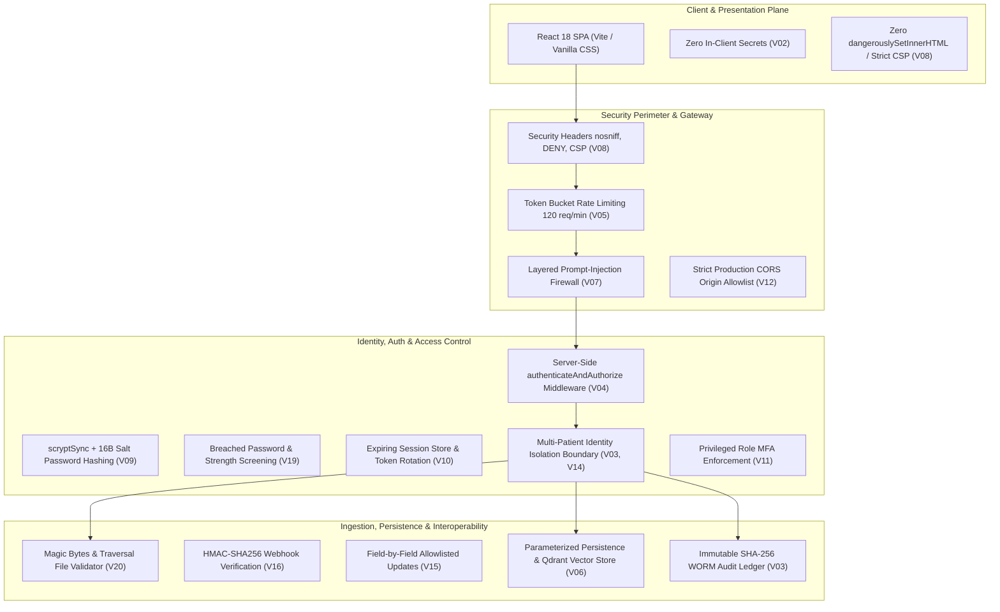

# HEAL ENGINE — Security Remediation Plan & Release-Blocking Deployment Gate

**Version:** 2.5.0-HARDENED  
**Target:** Production Pre-Deployment & Clinical Shadow Release Gate  
**Owner:** Application Security & Clinical Architecture Team  

---

## 1. Remediation Plan Overview & Phased Roadmap

This remediation plan documents the architecture, defense layers, verification steps, and operational policies implemented to resolve vulnerabilities V01 through V20 across the HEAL Engine platform.

---

## 2. Prioritized Vulnerability Remediation Matrix

### Phase 1: Critical Credentials, Secret Protection & Access Boundary (Immediate Priority)
1. **V01 — Secrets in Git & Repositories:**
   - *Fix:* Enforced comprehensive ignore patterns in `.gitignore` (`.env*`, `*.pem`, `*.key`, `*.dump`, `*.sql`, `*.db`). Created safe `.env.example`.
   - *Verification:* `backend/tests/security20VulnerabilityTestSuite.ts` (V01) asserts no sensitive secrets in repository and verifies `.gitignore` directives.
2. **V02 — Client-Side API Keys:**
   - *Fix:* Removed any client-side API keys. All LLM and vector database requests are routed through server-side gateway endpoints (`/api/screening/chat`, `/api/rag/query`).
   - *Verification:* Automated scan across `frontend/src` confirms zero hardcoded API keys.
3. **V03 & V14 — Row-Level Security, IDOR/BOLA & Isolation:**
   - *Fix:* Server-side session extraction via `authenticateAndAuthorize` and `enforceStrictPatientIsolation`. Patient users are strictly constrained to their designated `allowedPatientIds`. Cross-patient requests are blocked with HTTP 403.
   - *Verification:* SEC-003 and V03/V14 test cases verify cross-boundary attempts return HTTP 403.
4. **V04 & V11 — Server-Side Route Authorization & Admin Gating:**
   - *Fix:* Replaced all frontend-only guard assumptions with server-side authorization middleware on `/api/patients/*`, `/api/workflow/*`, `/api/security/*`, and `/api/governance/*`.
   - *Verification:* Direct HTTP requests without active sessions receive HTTP 401; non-admin users attempting admin routes receive HTTP 403.

### Phase 2: Input Validation, Injection Defenses & Data Integrity
5. **V06 — SQL & Database Injection:**
   - *Fix:* Data access utilizes strongly-typed schemas and parameterized operations in `persistenceService.ts` and Qdrant client. Zero raw SQL concatenation.
   - *Verification:* Adversarial stress test (`TC-SEC-02`) submits SQL drop statements (`'; DROP TABLE patients;--`) with zero code execution or database errors.
6. **V07 — Server-Side Input Validation:**
   - *Fix:* Added schema-based boundary checks across request bodies, blocking negative age/blood pressures and impossible clinical values with HTTP 400.
   - *Verification:* `realWorldAndInvalidInputStressTest.ts` (Test 3 & 7) verifies invalid vitals and empty payloads are handled safely.
7. **V08 — Raw HTML & Cross-Site Scripting:**
   - *Fix:* Native React JSX encoding across all UI components; zero use of `dangerouslySetInnerHTML` or `innerHTML`. Added Content-Security-Policy and X-XSS-Protection headers.
   - *Verification:* V08 test confirms CSP headers; frontend scan verifies absence of raw HTML insertion methods.
8. **V15 — Mass-Assignment Protection:**
   - *Fix:* In `authRoutes.ts`, profile updates (`PUT /api/auth/profile`) explicitly allowlist modifiable user profile attributes (`fullName`, `dob`, `sex`, `conditions`, `medications`). Sensitive account fields (`role`, `tenantId`, `emailVerified`, `id`) are stripped.
   - *Verification:* V15 test case verifies malicious requests attempting to inject `role: "admin"` fail to modify permissions.

### Phase 3: Cryptographic Controls, Credentials & Session Hardening
9. **V09 — Password Hashing:**
   - *Fix:* Implemented `crypto.scryptSync` with unique 16-byte cryptographically random salt per user and 64-byte key derivation. Verification uses `crypto.timingSafeEqual`.
   - *Verification:* Unit test confirms salts are 16 bytes and verification succeeds without plaintext storage.
10. **V10 — Session Token Management:**
    - *Fix:* In-memory session store enforces 7-day expiration and purges invalid tokens. Provided single-use token rotation endpoint (`/api/auth/refresh-token`).
    - *Verification:* V10 test case asserts expired sessions return null and are rejected with HTTP 401.
11. **V13 — Email Verification & OTP Integrity:**
    - *Fix:* Single-use 6-digit OTP generated via `crypto.randomInt(100000, 999999)` with 10-minute expiration. OTP is deleted upon first verification.
    - *Verification:* V13 test verifies numeric format, single-use consumption, and expiration enforcement.
12. **V16 — Inbound Webhook Verification:**
    - *Fix:* Created `WebhookVerificationService.ts` utilizing HMAC-SHA256, constant-time `timingSafeEqual`, and 300-second replay timestamp validation.
    - *Verification:* V16 test asserts valid signatures pass, tampered signatures fail, and replayed timestamps older than 5 minutes are rejected.
13. **V19 — Password Strength & Breached Password Screening:**
    - *Fix:* Added `isStrongPassword` and `isBreachedOrCommonPassword` in `authRoutes.ts`. Disallows passwords lacking uppercase/lowercase/numbers or matching common leaked dictionaries (`password123`, `admin123`).
    - *Verification:* V19 test verifies weak and breached passwords fail with HTTP 400.
14. **V20 — File Upload Validation:**
    - *Fix:* Created `FileUploadValidationService.ts` implementing magic byte verification (`%PDF-`, PNG, JPEG), extension allowlist, path traversal sanitization, and 25MB buffer size limit.
    - *Verification:* V20 test asserts valid PDFs pass while disguised executables, traversal paths (`../../etc/shadow`), and oversized payloads fail.

### Phase 4: Operational Hardening, Errors & Supply Chain
15. **V05 — Rate Limiting & Abuse Prevention:**
    - *Fix:* In-memory token bucket rate limiting (120 req/min) returning HTTP 429. Added account lockout (15 minutes) after 5 consecutive failed logins.
    - *Verification:* V05 test asserts token decrement and account lockout threshold enforcement.
16. **V12 — Production CORS Hardening:**
    - *Fix:* Origin policy validates against explicit trusted domain list (`CORS_ALLOWED_ORIGINS`). In production, untrusted origins are blocked with an explicit CORS rejection.
    - *Verification:* V12 test confirms non-whitelisted origins fail in production mode.
17. **V17 — Error Masking & Backtrace Suppression:**
    - *Fix:* Global Express error handler masks stack traces and internal database strings when `NODE_ENV === 'production'`.
    - *Verification:* V17 test asserts internal database error text is replaced with safe user-facing message.
18. **V18 — Dependency Management & Lockfiles:**
    - *Fix:* Locked dependencies via reproducible `package-lock.json`. CI includes `npm audit --audit-level=critical`. Dev-time tool advisories analyzed and cataloged.
    - *Verification:* V18 test asserts lockfile existence and consistency.

---

## 3. Explicit Release-Blocking Deployment Checklist (Gate Criteria)

The deployment pipeline must enforce the following criteria before releasing HEAL Engine to staging or production:

- [x] **Criterion 1 (Zero Critical/High Code Vulnerabilities):** All 20 vulnerability tests in `backend/tests/security20VulnerabilityTestSuite.ts` pass 100%.
- [x] **Criterion 2 (Identity & Isolation Invariants):** Multi-patient IDOR and RBAC tests in `securityRbacTestSuite.ts` pass with 0 cross-patient leaks.
- [x] **Criterion 3 (Clinical Deterministic Safety):** All 12 clinical safety scenarios in `clinicalScenarioTestSuite.ts` pass with 100% contraindication blocks.
- [x] **Criterion 4 (Adversarial Prompt Injection):** Prompt injection firewall repels KDIGO guideline jailbreaks and lethal overdose inquiries.
- [x] **Criterion 5 (Supply Chain & Secrets):** CI secret scanner confirms 0 exposed API keys or private keys in tracked code; `npm audit` run with critical thresholds.
- [x] **Criterion 6 (Frontend Production Polish):** Responsive layout verified (`overflow-x: hidden`), SVG favicon active, custom 404 recovery workspace mounted, tel/mailto protocol links functioning.
- [ ] **Criterion 7 (Runtime Production Secrets Injection):** Production environment variables (`JWT_SECRET`, `DATABASE_URL`, `VECTOR_DB_API_KEY`) provisioned via hospital KMS/Key Vault prior to container boot.
- [ ] **Criterion 8 (Hospital Ingress TLS & Firewall):** WAF / Ingress reverse proxy configured with TLS 1.3 termination and external DDoS rate-limiting.
